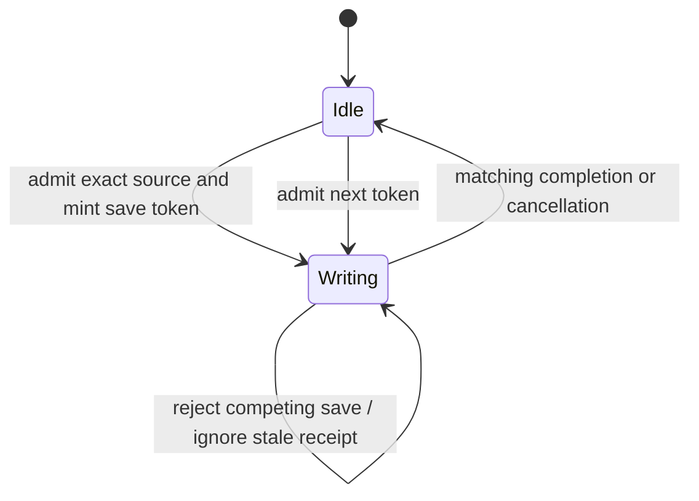

# Runtime state machines

This map covers first-party app/runtime Rust, the core crate and embedded browser
controllers. It separates lifecycle control from independent preferences, retained
user drafts, displayed results, immutable input/output and synchronous parser
stacks. Vendored engines implement their own protocols; app adapters still own
admission, cancellation and publication.

## Design decision

Use small domain-owned machines, composed where work can legitimately overlap.
Each exclusive phase owns its required payload. A displayed preview may remain
usable while a newer build fails; a drawing can change while an older recognizer
drains; a remote repository may exist even when attaching it locally fails.
Those facts must not be flattened into one global state or one busy flag.

- UX: retain drafts and good results, admit effects once, make cancellation honest,
  and explain the actual failure without letting stale events change current work.
- DX: named phases and transition methods own identities/resources; contradictory
  flag combinations cannot be constructed. Wire representations are decoded at
  boundaries rather than retained as ambiguous runtime state.
- AX: read-only inspection publishes actual phases and opaque operation/source
  identities. Tests exercise event sequences, not screenshots or transient
  notices as a substitute for completion receipts. No document contents are added
  to state logs.

A typed `Option` owning one complete resource, `Result`, a private queue membership,
or a revision-keyed cache can already be an explicit sum type. Independent
capability/settings flags remain data. Add an enum when it removes an invalid
combination or clarifies a lifecycle, not merely to rename a boolean.

## Transition contract

Asynchronous effects carry the owner, generation, source revision and request
identity available and appropriate to their provider. Validate those identities
before consuming a result or changing source. Unversioned Tinymist compile-status
notifications provide weaker readiness observations: preview follow checks the
service generation and edit time; those notifications do not authorize source
writes. Cancellation, supersession, failure, owner departure and completion are
explicit transitions. Terminal replies are consumed once; an old reply cannot
retire a newer request. Resource release remains RAII-owned and bounded. Retained
display data grants no mutation authority.

The shared save gate owns permission to write, while the local/Overleaf/offline
backend owns IO. Their token connects two distinct owners. A receipt still
records committed bytes on its original document; releasing a close continuation
also requires the matching live operation and durable synchronization.

## Document, work and storage

| Owner | Explicit model and contract |
|---|---|
| `core/document`, `document`, `mitex_document` | DocumentKey(owner, epoch, revision), edit transaction, source projection, save request/receipt/status and undo history. Dirty derives from committed source identity. |
| `core/workflow`, `workflow` | Exclusive queued/executing/prompt/dialog phases, token-owned save continuation and source-bound close permission. SaveState Idle/Writing owns SaveOperationId, source key and Local/Overleaf/Offline domain. |
| `app/saves` | Idle/Writing owns both the local worker and PendingSave. Worker metadata and receipt routing cannot be split. Stale terminal replies never release a newer save gate. |
| `core/closing`, `app/lifecycle`, `windowing` | Close approval batches and document lifetimes retain exact page identities until durable departure. The process-close request owns its original document key even after its last tab retires. Background mutations drain before retirement. |
| `worker::LatestJob` | Idle/Running/Failed owns replaceable completion; supersession drops old acceptance, failure is delivered once. |
| `worker::ExclusiveJob` | Idle/Running/Failed owns originating name, shell and completion. Shared Working/Ready/Detached states serialize owner-close/completion races; effects retain a receipt after the owner leaves. |
| `worker/latest_queue` | Open/ SenderClosed/ReceiverClosed owns latest payload. Closing the sender drains one latest item; closing the receiver drops queued data and rejects later sends. |
| `index_jobs` | Idle/Pending owns request+source identity; terminal replies consume that identity once. FIFO/coalesced queue and active cancellation are separate scheduler owners. |
| `workspace_service` | Subscription root+generation owns routing; a pending change batch owns its deadline and content/structural payload. One structural scan per flush. |
| `save_transaction`, `save_io` | ExpectedDiskState, SaveIntent, WriteDurability and committed/precommit Result separate failure from committed-but-uncertain writes. Validated paths and leases protect IO. |
| `private_workspace`, `process`, `resource_lock` | Owned temporary directories, child/process-group handles and resource leases define linear cleanup obligations, including partial construction. |
| `resource_repair` | The running task owns component, cancellation and worker. Retained completion messages are independent feedback, not readiness flags. |

## Build, language and preview services

| Owner | Explicit model and contract |
|---|---|
| `compiler/tex` | Idle/Admitted/Running build ownership and bounded direct-pass execution. Start is announced once; repeated engine passes preserve request identity. |
| `compiler/typst` | Awaiting/Compiling/Settling owns revision and terminal publication; quiet-period admission cannot reuse an earlier source completion. |
| `core/connection`, `core/recovery` | Offline/Starting/Ready connection and bounded running/waiting/exhausted/permanent recovery. Generations belong to live phases; displayed endpoint is independent retained data. |
| `preview`, `core/preview` | Backend/service/content/recovery compose explicitly; canonical Empty/Pending/Ready and resident raster are independent. PreviewTransitionEvent/Effect owns backend handoffs. |
| `tex/session` | Initializing/Ready owns negotiated synchronization and optional OpenDocument(identity+source). No opened source can precede readiness. |
| `tex::TexService` | ProviderState NotReady/Ready/Failed replaces independent readiness/error flags. Provider session handles and current snapshot own subprocess/source identity. |
| `ltex` | Worker initialization/document phase, Checking/Suggestions and Current/Superseded validity distinguish safe drain from cancellable suggestion work. |
| `app/ltex` | Stopped/Starting/Ready/Failed service phase; Inactive/AwaitingSnapshot/Unsubmitted/Checking/Complete/Rejected source-check phase. URI, sent version and source identity travel together; source edits cannot revive a fatal service. |
| `tinymist` | Initializing/Initialized/StartingPreview/Running subprocess with typed pending requests and generation/deadline admission. Stop and cleanup own their process resources. |
| `tinymist_sync` | Stopped/Active owns generation and open URIs; CurrentDocument Absent/Selected/Opening/Open separates selected source from confirmed service ownership. |
| `app/formatting` | Idle/WaitingForSavedDocument/WaitingForMathDocument/Requested owns exact source key, unique request token and Edit/Save intent. Success and failure require the token and service/source identity, including repeated requests for unchanged source. Completion consumes intent once. Manual-save intent cannot leak into a math-conversion request. |
| `app/preview_follow` | AwaitingCaretAndCompile/AwaitingCaret/AwaitingCompile/Debouncing preserves either event order. Capture the final edit caret once; compilation/readiness events wake work, idle frames do not poll. |
| `liquid_process`, `liquid_runtime` | Available/AwaitingReply/Stopped exchange and Ready/Invalidated model health. One in-flight native request; terminal pipe health remains separate from a final queued reply. |
| `terminal/session` | Typed process status, Collecting/Overflowed replies, Quiet/Pending output-frame coalescing. Process lifetime, visibility and output readiness remain independent. |
| `preview_zoom_snapshot` | Idle/AwaitingSnapshot/Snapshotting/PreparingRaster/DeferredRaster capture ownership and Empty/Awaiting/Deferred(image, scale) admission. Mirror Parked/Loading/Ready owns its exact native navigation. RenderFlight owns request and original raster token through completion; retiring cached pixels cannot retire a live render receipt. |
| `preview_zoom_snapshot.js` | Idle/Scheduled/Capturing/Admitting warming and Idle/Rendering/Handoff native flight own exact capture, renderer and source epoch. Cached pixels remain independent usable display data through newer work. |
| `preview_navigation.js` | Idle/Scheduled/Running/Disposed partial execution, Idle/Geometry/Render demand and owned queued input preserve bounded scheduling. Destination cues own AwaitingLocation/AwaitingVisibility/Displaying and their exact animation callback. |
| `lsp/protocol` | Typed framed requests/results and validated coordinates. Successful formatting `null` normalizes to an empty edit list; JSON-RPC errors stay errors. No-edit success reports “No formatting changes.” |

## Overleaf

| Owner | Explicit model and contract |
|---|---|
| `overleaf/model::Document` | Synced/Draft/Conflicted owns local text and review obligation; Cached/Verified authority belongs to that document. Existing journal representation remains unchanged at the serde boundary. |
| `overleaf/model::Model` | Unbound/AwaitingTree/Ready project binding and Idle/AwaitingAcknowledgement publication own project/tree/request identity. |
| `app/overleaf::SavePhase` | Idle/AwaitingAcknowledgement/WritingMirror owns entity and exact shared save token through publication and durable local copy. |
| `app/overleaf` mirror receipts | A committed journal head and permission to install source are independent facts. Epoch/root/bound workspace profile own the physical receipt; the login browser may stage a different profile without discarding or claiming it. Queued work captures the bound profile. Exact predecessor comparison advances the physical head even when browser, stale source, rename or hydration admission rejects installation. Repeated writes to one entity retain the first predecessor and final written head; later file failures cannot erase earlier committed receipts. |
| `app/overleaf` staged-login save receipts | A bound offline workspace can finish its own save while another login is open. Each receipt must match the current Overleaf entity/operation and global operation/submitted key. Success acknowledges only that saved snapshot; failure retires only that ticket. Newer edits stay dirty. Passive batch members, browser errors, hydration and navigation retain their separate live-browser fence. |
| `app/overleaf/workspace` | Unrestricted/AwaitingTree/Copying/Ready hydration requires metadata and every current file receipt. Renames/changed files require fresh receipts; cached online content is not automatically editable. |
| `app/overleaf/offline` | NotRequested/WaitingForProject/Opening/Complete page restoration owns its bounded plan; Idle/Writing/Failed checkpoint writer owns the requested session and avoids idle retry loops. |
| `overleaf/offline` | Optional PendingWrite is write-ahead transaction ownership; matching disk/checkpoint recovery retains committed or predecessor state. Source journals are immutable validated records. |
| `overleaf/offline`, `mirror::unix` rename effects | Same-ID document moves retain original bytes until the new source and journal commit. Passive source freshness is checked before retargeting/coalescing work. Retirement needs both matching bytes and positively distinct no-follow file identities; a case alias cannot delete the committed target. Verified macOS exclusive metadata renames preserve owned file/folder spelling without overwriting distinct destinations. |
| `overleaf_browser` | PageAuthority Uncommitted/ProjectPage/Browsing admits IPC only from the committed owned page. Recovery Watching/AwaitingReturn/Cancelled preserves explicit navigation intent. |
| `app/overleaf` browser UI | Closed/Creating/Ready(native browser)/Failed owns native creation. Authentication Unchallenged/Required/ReturnAttempted/RequiredAfterReturn preserves the automatic-return budget. Idle/Awaiting(epoch) project adoption is one-shot; browser visibility is independent. |
| `app/overleaf/review` | Unrequested/Computing(revision, job, previous)/Ready/Failed comparison, with Current/Stale review validity. Failed comparisons latch by revision; prior comparison remains readable without granting acceptance. |
| `app/overleaf/files` | Idle/Editing/Submitting/Uncertain owns dialog and exact mutation receipt. Locked/Writable(epoch) is independent authenticated capability. Timeout and disconnection retain uncertain intent without retry; fresh capability permits reconciliation. |
| `app/overleaf/follow` | Seek/Follow navigation mode composes Waiting/Opening/At(source, head, camera cue). Opening retires obsolete camera authority; a matching source applies its owned cue once. |
| `overleaf_bridge.js` | Named link/store/socket/bootstrap/open/save/file-operation phases own their receipts. Editing/Sent/Acknowledged/Confirming publication cannot be inferred from independent booleans; uncertain file changes require reconciliation rather than automatic retry. |
| `overleaf/workspace_session`, `presence`, `inbox`, `storage` | Persisted page provenance and peer caches are independent data; bounded mailbox/failure delivery and owned storage leases define authority and cleanup. |

## Editor, review and native interaction

| Owner | Explicit model and contract |
|---|---|
| `app/diagnostic_fix`, `app/liquid` | Idle/Running/Cancelled admission owns exact request/cancellation/progress. Preparing/Ready/Failed/Stale review separates partial display from an acceptable final replacement. Wrong-id replies preserve current work. |
| `app/latexdiff` | Idle/Picking/Generating/Cancelling owns dialog or process, never both. Cancel drains the owned worker; durable creation is handed off once. |
| `app/table_samples` | Unrequested/NotNeeded/Sampling/Ready/Failed owns sampling; display View is a projection, not independent pending/grid/error fields. |
| `app/citation` | Query/Picking/LookingUp/Review/Importing/Imported uses different typed lookup/import jobs. A published receipt retains its exact reviewed bibliography and cannot be imported twice. |
| `app/tex_documentation` | Idle/Searching/Loaded/Failed owns search/cancel; previous results and online fallback may remain visible after failure. |
| `app/demo`, `app/workspace_creation` | Idle/Picking/Creating owns native picker or creation worker, retaining the originating workspace and editable form. Workspace creation retains its completed result until the active save retires, so an autosave admitted while the form is open keeps its account and completion owner. |
| `app/settings_panel` | Form/Json/Help is one mode. JSON and form drafts are independently retained user work; an invalid draft never becomes applied preferences. |
| `font_preview` | Empty/Loading/Ready/Failed owns request and worker. Bounded sample LRU is independent; identical failed requests cannot retry on idle frames, changed requests recover. |
| `explorer` | Closed/Opening/Open owns one-shot width restoration. Queries, section/filter choices and startup-size policy remain independent. |
| `app/find_bar` | Inactive/Requested/Engaged/BlurGrace focus preserves native handoff and sustained external blur. Find/replace text and mode remain retained presentation data. |
| `app` editor hover | Unrequested/Pending/Complete/Unavailable owns completion authority independently from displayed hover text. Empty results are completed results; duplicate or stale replies cannot repopulate them. |
| `child_view`, `window_logo`, app popup/rename/modal | PopupFocus AwaitingFocus/Focused/BlurGrace; ModalFocus AwaitingFocus/Focused/Suspended. Unknown OS focus is not a close. Only the owner resumes suspended modals; no geometry contract changes. |
| `app/table_editor` | Closed/Selected/Editing boundary draft owns its target, text and validation. A previous edge error cannot attach to another selection. Width-drag Option owns a complete gesture; write-ratios is an independent preference. |
| `handwriting` | Settled/Drawing/Queued demand and Idle/Running/Failed worker own generations separately; ink remains editable while older work drains. Stale success/failure cannot publish, and Undo to empty retires obsolete failure. |
| `app/tabs`, `tabs/motion` | Unassigned/Automatic/Pinned/Closed preview ownership preserves the automatic anchor and single-tab fallback. Idle/Held drag and Settled/Sliding/Grabbed/Landing motion own gestures; editor and preview identity remain separate. |
| `app/workspace_switch` | Optional Pending owns destination, approved document keys and bounded departure continuation. Old-owned pages retire only after every approval/checkpoint completes. |
| `app/pdfium_state` | Render Idle/Requested/Received/Settled, search Unrequested/Queued/Requested/Ready and owned pending navigation compose independently. Returning from search A to B to A cannot strand a request; reflow of a retained PDF cannot consume a new source's jump. |
| `app/version_history` | Independent inventory/comparison/backup/PDF workers own different tasks. Typed Choice and requested pair guard stale publication while old results remain visible. |
| completion/snippets/navigation | Tagged completion provenance and source-bound request/session/ranges own acceptance; a displayed item or caret observation is not a request in flight. |

## Git and external effects

| Owner | Explicit model and contract |
|---|---|
| `git::GitPanel` | Idle/Running owns workspace, foreground/background mode and job. Refresh demand can coexist with queued mutation; displayed diff is independent retained data. |
| `git/editor` | Shared Debounce owns refresh demand/deadline, replacing a second pending flag. Source-bound hunks still revalidate the baseline before mutation. |
| `github::CreatedRepository` | Requested/Confirmed(nonzero repository id) owns authoritative remote identity. Attaching returns the verified identity with local snapshot; no generic confirmed=true write. |
| `app/git_setup/github` | Idle/Preparing/WaitingForBrowser/DeviceCode/Cancelling owns sign-in state/code. Inspection labels derive from variants; late progress cannot revive cancelled work. |
| `app/git_setup` | Idle/Running owns operation request, job, cancellation and progress together. Retained uncertain-creation archive remains separate durable recovery data. |
| Git repository / GitHub CLI executors | Typed operations, reviewed snapshots, bounded synchronous processes and leases own effects. Existing durable creation intents prevent duplicate remote POST after uncertain acknowledgement. |

## Caches, queues and pure subsystems

Asset/thumbnail loads use latest-request ownership, token-bound results, stop
signals and RAII worker handles. Image ResidencyLease owns resident/evicted GPU
budget authority; visibility and accounting are independent facts.
GPU pipelines own Cold/Ready/Unavailable/Destroyed lifecycle; shared availability
is observed atomically rather than inferred from independent failure flags.
Tooltip focus owns Passive/FocusRequested/Focused/Dismissed intent separately
from the operating system's current focus observation. Screenshot
requests atomically move from queued to in-flight ownership and consume their
capture tokens once. Read-only desktop probes never authorize effects. Their
renderer view owns Idle/Pending(one-use RendererRequest) observation; retained
samples remain readable during a new observation. Native reload generations stay
separate from observation request identities, so old callbacks cannot publish or
retire a newer request. Wheel observations use a context incarnation and a
one-pass token, because a reopened viewport can reuse both its ID and frame
number. Bounded native routing and source-navigation traces are opt-in/test-only;
normal source navigation installs no diagnostic method wrappers.

Search compiled-query variants, revision-keyed editor/highlighter/folding caches,
workspace filtering, font/catalog caches and writing dictionaries keep valid
memoized products separate from pending IO. Negative cached lookups are valid
products. Parsing, UTF-16 mapping, auto-pairs, comment controls, math conversion,
color/font transforms and import analysis are synchronous transducers with local
stacks or typed results. Style flags, capabilities, filters, resolved preferences,
OS observations and profiling counters are not mutually exclusive phases.

## Verification record

Required Rust checks pass: formatting, strict Clippy for all default targets,
3,810 tests with 89 opt-in tests ignored, and 55 xtask tests with one ignored.
Strict Clippy also passes with both `desktop-ui-tests` and `profiling` enabled.
The full `profiling` test run passes 3,818 tests with 89 opt-in tests ignored.
The script suite passes 701 tests with one skipped; browser-controller tests
pass 421 cases. The earlier pinned real Tinymist full/partial edge probe passed 24
before the source-navigation anchor correction.
Native interaction evidence is tracked separately from these deterministic
checks and from framebuffer captures.
The [final check record](performance-results/state-machines-final-validation-2026-11-19.json)
retains the commands, counts and matching source identity before/after the runs.

Focused failing reproductions were retained before fixing unrelated
diagnostic/Liquid replies, duplicate index completion, discarded committed
Overleaf checkpoint receipts, stale
handwriting failure and successful null formatting. The exact display-math case
was checked with real Badness and Tectonic: ordinary multiline math and comment
spacing are valid; a blank paragraph inside `\[...\]` is not. Its misleading
endpoint cascade is replaced only when both exact diagnostics and a paired
paragraph break are verified against the provider snapshot.
Conditional TeX is deliberately left to the provider: skipped branches can
contain valid blank paragraphs, so they cannot justify this stronger explanation.

No new polling loops, background workers, idle filesystem reads or content logs
are introduced. Existing wakeups, bounded queues and passive deadlines remain
the performance contract. Preview JavaScript baseline/after operation counts are
retained in [the local measurement](performance-results/state-machines-preview-2026-11-18.json).
The [native scheduler component measurement](performance-results/state-machines-native-preview-2026-11-18.json)
also retains identical dispatch/replacement/completion counts before and after;
its component timings are not composed-window latency measurements.
The [tab-motion measurement](performance-results/state-tab-motion-2026-11-18.json)
retains identical positions, state size and transition counts; its small timing
difference is treated as noise. Formatting admission adds one relaxed atomic
increment per request, with no idle-frame work.
The [diagnostic-event component measurement](performance-results/tex-paragraph-normalization-2026-11-18.json)
records about 0.48 ms added for the verified cascade in a 95 KB source with 1,002
findings. Unrelated findings use the early exit; their timing difference is noise.
This is work on diagnostic publication, not per-frame or idle work.

Enclosing delimiter lookup derives its endpoint and interval indexes once per
document revision, then reuses them while the caret moves. The
[bounded-query record](performance-results/state-machines-delimiter-queries-2026-11-18.json)
covers both languages, long sibling lists, deep nesting and edit invalidation.
Persistent pair highlighting also reuses the editor's existing indexed cursor
coordinates; the
[coordinate measurement](performance-results/enclosing-pair-coordinates-2026-11-18.json)
checks equal geometry without repeatedly scanning all preceding rows. These are
component measurements, not whole-app rendering or idle-performance claims.
An edited revision still rebuilds each cache owner's index: Typst walks its
incrementally parsed AST, and the editor, input buffer and highlighter retain
their separate TeX caches. Warm-query reuse does not establish lower typing
latency.

Rename identity checks and spelling repair run only in the existing storage
worker, on changed owned paths or postcommit cleanup. They add bounded metadata
work, with no frame scanning, new worker, polling or idle IO. A successful physical
rename does not guarantee that Git stages its case change: the default
`core.ignorecase=true` can retain the previous index spelling even after
`git add --all`. Storage synchronization deliberately does not mutate the Git
index or configuration.
The [case-rename correctness record](performance-results/state-machines-case-renames-2026-11-18.json)
retains the actual filesystem probes, two failing-before data-loss cases, 108
passing real-module tests, source hashes and commands. It includes stored
spelling, inode, crash/reopen, local-edit, hard-link and no-follow checks; it is not
a speed or composed-window measurement.

The [staged-profile receipt record](performance-results/state-machines-staged-profile-receipts-2026-11-18.json)
reproduces a real completed refresh followed by a false “updated in another
window” conflict. The bound workspace now retains that commit independently of
the staged login browser. Follow-on queued work keeps the same physical owner;
wrong profiles, roots and epochs cannot claim its head or install source.

### Native interaction evidence

The focused TeX editing and intelligence journeys passed with real Badness:
successful no-edit formatting preserves source, and ordinary multiline/comment
spacing stays clean while blank and whitespace-only paragraphs get one accurate
Badness finding. Six fresh viewport PNGs were inspected under
`.tiptoptyp/screenshots/agent-review/state-machines-2026-11-18`; the message and
Problems row have no duplicate endpoint reports or clipping.

The extended TeX editing journey also passes command-math auto-closing,
environment completion, closer overtype, atomic deletion/undo, literal paste,
disabled completion and persistent innermost matching in both languages. Native
indentation and selection wrapping pass separately, including mixed space/tab
indentation and the document environment's existing body-indent rule. Fresh TeX
pairing frames and a release-build Typst interior-caret frame were inspected in
`.tiptoptyp/screenshots/agent-review/pairing-2026-11-18`: endpoint backgrounds have
no outlines, with correct text placement and clipping. The maintained 25-image
gallery was regenerated in one app session and passes `--validate-latest`.

Unchanged paths also passed native workspace departure, empty startup, background
preview, citation import, latexdiff generation/compilation/cancellation, TeX
documentation/magic, Git/GitHub setup, actual Liquid selection review/streaming,
foundation-model diagnostic review/apply/cancel, LTeX and partial zoom stress.
The initial Settings shortcut timeouts remain recorded; later controlled
background-preview and Liquid runs passed. Passive activation observation did not
establish a causal focus defect, so no speculative focus patch was applied.

The storage/account validation binary is `/private/tmp/ttt-complete-app` (SHA-256
`cae0aa61ed2c764750c004c026247d5811f9a2dee3a0c29652e62dc955205445`).
Its full standalone Overleaf workflow passes, including file creation,
duplication, cross-language rename, move/delete, isolated account staging,
original-profile Reset, reconnect merges, conflict review and cleanup
(`run-xugisgqc`). Workspace reopening, offline recovery and separate profile
lifecycle also pass (`run-fcl0k3wv`). The combined run passed Explorer, Overleaf,
Activity, indentation, Problems focus and preview find before its compact-table
wheel check failed (`run-nn4b7mbx`); that run is not a pass.

The same wheel failure was reproduced with bounded read-only diagnostics. In
`run-3fh9adi1`, both Typst table openings received wheel input and scrolled. The
first TeX opening received no new wheel at the native event boundary or in egui,
despite the driver posting the same plain-wheel configuration inside the focused
table window. The separate wheel trace budget was not exhausted. This establishes
a delivery gap before the grid, without identifying its cause; neither a table
patch nor an input retry is justified by that evidence. An explicit ordered
49-journey suffix on the diagnostic build
`/private/tmp/ttt-wheel-all-app` (SHA-256
`8d02fc96b8887eb6b714c9fae68adbeaab2e6398c2d212f9b6d89c9418d93755`)
passed arXiv tables, math grids, file versions and the command palette, then
stopped at a partial-preview source jump. It does not waive or count the failed
table check. The same build separately passes the complete TeX editing,
intelligence and saving journeys; its preview-scroll setup failed, and the
remaining TeX journeys were not run.
The [native input boundary review](performance-results/state-machines-native-wheel-boundary-2026-11-18.json)
retains the emitted/delivered distinction and the exhausted lifecycle-trace caveat.

The source jump exposed a competing resize owner. Exact methods extracted from
the pinned frontend reproduce a retained resize anchor cancelling a new smooth
source jump on the following cursor patch, both before and after the phase
refactor. An admitted current-renderer location now retires that anchor before
forwarding the original handler. Invalid or foreign locations cannot claim it.
The [source-navigation correctness record](performance-results/state-machines-preview-source-navigation-2026-11-19.json)
retains the before/after controls and regression coverage. On the rebuilt app,
the formerly failing partial forward/inverse jumps and detached inverse checks
pass. Full Tinymist still fails its forward jump despite healthy cache readiness;
that complete journey remains failed. The
[native validation record](performance-results/state-machines-native-validation-2026-11-18.json)
lists artifact identities, exact selections, successful subcases, failed runs and
fixture limitations separately. No complete aggregate pass is claimed.
The [direct full-mode diagnostic](performance-results/state-machines-full-navigation-diagnostic-2026-11-19.json)
also reproduces the failure on a real file opened through the normal CLI, without
a file chooser or prior backend transition. A valid positive smooth-scroll
request reaches the current scroll element; resize anchors are absent and the
two observed rescales show no net position change. The cause below that request
remains unresolved. The test-build trace does not justify naming a browser/host
defect or changing normal navigation behavior speculatively.

The [separate native zoom correctness record](performance-results/state-machines-native-zoom-correctness-2026-11-18.json)
passes 43 owned-view partial-renderer transitions (maximum anchor error 0.95 CSS
pixels). Full rendering passes responsiveness and one final vector request, but
fails the idle-refresh readiness precondition identically in frozen baseline and
current code; its transitions are not a pass. These owned-view checks do not
establish composed editor geometry. The desktop `partial_cache_edges` journey is
unavailable while macOS scroll-to-zoom owns global Ctrl-wheel; no zoom input was
posted and that system preference was preserved.

### TeX autofix scan

`src/app/autofix.rs::State` is Idle, Running(Task), Cancelling(Task), or
Failed(message). The task owns the exact document key and immutable source,
enabled rules, comment markers, tool resolution, cancellation handle, and one
result receiver. Its purpose is an editor action or a save carrying the exact
target tab, destination, save intent, formatter follow-up and close continuation.
Repeated shortcuts do not duplicate a running or draining scan. Editing,
document departure, closing, changed preferences, or a read-only owner cancels
admission. Cancelling retains the worker until its bounded subprocess exits;
late results cannot edit another source or retire a newer task. A successful
current result validates every original byte span and applies all selected
nonoverlapping fixes in one document edit/undo transaction. A no-op does not
change revision or undo history. Opt-in save preparation also supports parked
tabs; it edits only that tab and hands the corrected revision to the ordinary
durable-save lifecycle. Admission rechecks destination and Overleaf conflict
guards before editing. Formatter resaves bypass preparation to prevent loops.
A stale or cancelled save leaves the draft dirty; autosaves are rescheduled and
explicit saves report that another save is needed. Liquid's separate review
lifecycle is unchanged.
Activity exposes TeX autofix; desktop inspection reports idle/running/cancelling/
failed without source contents. Completion wakes only its owning viewport;
there is no polling repaint loop or idle disk work.

### TeX closer prefix input

`src/auto_pairs/provisional.rs::State` is Idle or Borrowing(CloserPrefix).
This editor interaction is separate from the syntax cache. Its payload owns
the exact document revision, stable tab ID, source/diff widget scope, validated
closing-token span and text, consumed byte/scalar prefix, and last painted
viewport frame. Equal document keys in different tabs cannot share provenance.

Only a committed typed backslash over a parser-matched closing command begins
borrowing. Matching characters advance the prefix and complete the closer
without changing source or Undo history. Divergent typing inserts its text and
restores the borrowed prefix before the original remainder; the caret stays
after the user's text. A batch that completes the closer and contains following
text completes first and processes the remainder normally. Backspace rewinds
the virtual overstep without deleting a closing command. Capacity failures
leave both source and borrowed state intact.

Ordered native input receipts retire provenance before manual navigation,
pointer/selection changes, modified deletion, paste, IME, cut and Undo. Moving
away and back within one frame does not revive it. Paste and IME insert literal
payloads at their current caret. Exact token/caret/revision checks fence every
continuation and rewind. The owning editor transaction can admit its resulting
revision only when its final token, caret and owner still agree.

Read-only, disabled and unfocused editors cancel ownership. Viewport paint
receipts also retire state when a source surface is hidden, replaced by another
panel, or stops painting; tab/document service departure cancels explicitly.
Desktop inspection exposes `auto_pair_phase` as idle/borrowing without token or
document contents. Idle checks inspect only the phase; active checks compare
the closing token, and input receipts are bounded by the current event batch.
This lifecycle adds no worker, timer, repaint loop or idle source scan.
